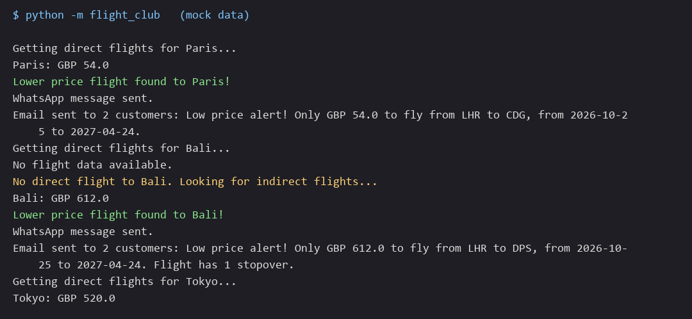
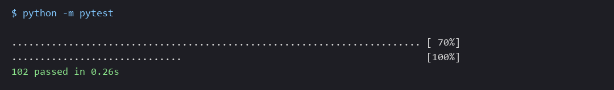

# 🚀 Personal Flight Club

A flight club (Day 40 of Udemy's "100 Days of Code: The Complete Python Pro Bootcamp"): it reads destinations and price limits from a Google Sheet, finds the cheapest return flight (direct first, then with stopovers), and emails every customer in a second sheet when a price is below the limit. It is for course participants who want to compare solutions and for anyone who browses the repository for ideas.

## 📚 Table of Contents

- [Overview](#-overview)
- [Requirements](#-requirements)
- [Setup](#-setup)
- [Run](#-run)
- [Tests](#-tests)
- [License](#-license)
- [Links](#-links)
- [Appendix: Project documents](#-appendix-project-documents)

## 🧭 Overview

The program keeps the assignment's class and function names. It builds on the Day 39 project and adds three things: a search for flights with stopovers when no direct flight exists, a customer list from a second sheet, and a deal email to every customer.

| Module (`src/flight_club/`) | What it does |
| --- | --- |
| `data_manager.py` | `DataManager`: reads the `prices` and `users` sheets from Sheety (`get_destination_data()`, `get_customer_emails()`) and writes a new lowest price back; reads all its settings in `__init__()` |
| `flight_search.py` | `FlightSearch.check_flights(..., is_direct=True)`: asks SerpAPI Google Flights, or the course's mock flight service, for nonstop flights, or for flights with up to two stops |
| `flight_data.py` | `FlightData` (with `stops`) and `find_cheapest_flight()`: picks the cheapest flight, with `N/A` when there is none |
| `notification_manager.py` | `NotificationManager`: builds the direct or stopover message, sends it by email with `send_emails()` and by WhatsApp |
| `main.py` | Wires everything together; `python -m flight_club` runs it |
| `constants.py` | All constants (URLs, origin airport, currency, SMTP port, variable names) |
| `cache.py` | Local response cache that never stores the Sheety answers |



### Glossary

| Term | Meaning |
| --- | --- |
| API | Application programming interface: how one program asks another for data |
| CI | Continuous integration: the checks that run on every pull request |
| GBP | Pound sterling; the currency code used in all messages instead of the pound sign |
| IATA code | The three-letter airport code of the International Air Transport Association, such as `LHR` |
| SMTP | Simple Mail Transfer Protocol: how the program hands an email to your mail provider |
| Stopover | An intermediate stop of a flight; a direct flight has none |

## 📋 Requirements

- Python 3.13 or newer.
- Runtime packages (installed by pip): `requests`, `requests-cache`, `python-dotenv`. Email uses the standard library (`smtplib`).
- Optional, only to send WhatsApp messages: `pywhatkit`, a browser and a logged-in WhatsApp Web session.
- A Sheety project for your copy of the Google Sheet with a `prices` sheet and a `users` sheet (Bearer authentication, PUT enabled on `prices`), and either a SerpAPI key or the course's mock flight service credentials.
- An email account with an app password (not your normal password) to send the deal emails.

## 🛠️ Setup

Create and use a local virtual environment, then install the project.

PowerShell (Windows):

```powershell
py -3.13 -m venv .venv
.\.venv\Scripts\Activate.ps1
python -m pip install --upgrade pip
python -m pip install -e ".[dev]"
```

Bash (Linux, macOS):

```bash
python3.13 -m venv .venv
source .venv/bin/activate
python -m pip install --upgrade pip
python -m pip install -e ".[dev]"
```

For WhatsApp delivery add the optional extra: `python -m pip install -e ".[whatsapp]"`.

Create your own `.env` from the template and fill in your values. `.env` is ignored by git; never commit it.

```bash
cp .env.example .env
```

| Variable | Meaning |
| --- | --- |
| `SHEETY_PRICES_ENDPOINT` | Endpoint of the `prices` sheet in your Sheety project (the Day 39 name `SHEETY_ENDPOINT` still works) |
| `SHEETY_USERS_ENDPOINT` | Endpoint of the `users` sheet that your Google Form fills (columns `firstName`, `lastName`, `email`) |
| `SHEETY_TOKEN` | Bearer token of the Sheety project |
| `FLIGHT_PROVIDER` | `serpapi` or `mock` |
| `SERPAPI_API_KEY` | Your SerpAPI key (provider `serpapi`) |
| `MOCK_FLIGHTS_APP_ID`, `MOCK_FLIGHTS_APP_KEY` | Credentials of the mock flight service (provider `mock`) |
| `MOCK_FLIGHTS_URL` | Optional: override the mock service URL |
| `SMTP_ADDRESS` | Your mail provider's SMTP server, for example `smtp.gmail.com` (port 587, STARTTLS) |
| `EMAIL_ADDRESS`, `EMAIL_PASSWORD` | The sender address and its app password |
| `WHATSAPP_NUMBER` | Your own number with country code, for example `+441234567890` |

Keep 3 to 5 destinations in the sheet to stay inside the free tiers (SerpAPI 100 searches a month, Sheety 200 requests a month). Flight answers are cached for one hour in `flight_cache.sqlite`; delete the file to force fresh searches. Try the program with a test `users` sheet that holds only your own address before you use the real customer list.

## ▶️ Run

```bash
python -m flight_club
```

or, after the editable install, `flight-club`. For every sheet row the program prints "Getting direct flights for ...". When there is no direct flight it prints "No direct flight to ... Looking for indirect flights..." and searches again with up to two stops. When the cheapest price is lower than the sheet's lowest price, it updates the sheet, sends a WhatsApp message and emails every customer in the `users` sheet. The message says "Flight has 1 stopover." for a flight with stops. Without the SMTP settings, `WHATSAPP_NUMBER` or `pywhatkit` it prints the message instead.

## 🧪 Tests

The tests use no network, send no email or WhatsApp message and never read your `.env`.

```bash
python -m pytest
```



Optional checks used by the CI: `python -m ruff check .`, `python -m ruff format --check .` and `python -m mypy --strict src tests`. Build the API documentation with `doxygen Doxyfile` (output in `docs/doxygen/`).

## 📄 License

See [LICENSE][license].

## 🔗 Links

- [Repository][repository]
- [Documentation][documentation]
- [Issue tracker][issues]

## 📎 Appendix: Project documents

The documents a newcomer needs, in reading order.

| Document | What it tells you |
| --- | --- |
| [AGENTS.md][agents] | The rules AI agents follow in this repository |
| [Business Case][BC-001] | Why the project exists, its scope and success criteria |
| [Stakeholder Analysis][SA-001] | Who is involved; the stakeholder IDs used for owners and reviewers |
| [Project Plan][PP-001] | The gateways and their schedule |
| [Milestones][milestones] | One document per gateway: Go/No-Go criteria and tasks |
| [Architecture decision][ADR-0001] | Why the code is one flat package that prints to the console |
| [Artifact registry][registry] | Where each artifact type lives, the next version, the PO language and domain |
| [Framework README][framework-readme] | The framework this project uses |
| [Framework changelog][framework-changelog] | What changed in each framework release |

---

[license]: ./LICENSE
[repository]: https://git.tirsystem.com/Tirsvad-Udemy-100-days-of-code/040-personal-flight-club
[documentation]: https://git.tirsystem.com/Tirsvad-Udemy-100-days-of-code/040-personal-flight-club/wiki
[issues]: https://git.tirsystem.com/Tirsvad-Udemy-100-days-of-code/040-personal-flight-club/issues
[agents]: ./AGENTS.md
[BC-001]: ./docs/business-case.md
[SA-001]: ./docs/stakeholder-analysis.md
[PP-001]: ./docs/project-plan.md
[milestones]: ./docs/milestones/
[ADR-0001]: ./docs/adr/adr-0001-flat-module-layout-and-console-output.md
[registry]: ./docs/artifact-registry.md
[framework-readme]: ./framework/README.md
[framework-changelog]: ./framework/CHANGELOG.md
