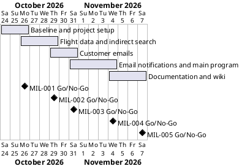

# Project Plan

## Metadata
| Key | Value |
| --- | --- |
| ID | PP-001 |
| CrossReference | [BC-001], [SA-001], [MIL-001], [MIL-002], [MIL-003], [MIL-004], [MIL-005] |
| Language | en |
| Domain | it |

## Version History
| Date | Status | Author | Reviewer | Change | Commit |
| --- | --- | --- | --- | --- | --- |
| 2026-10-24 | Accepted | Jens Tirsvad Nielsen | S01 | Initial version | [c5a6ed5] |

---

## Purpose

This plan schedules the five phases that deliver the Day 40 flight club (see [BC-001]) in a two-week window. One branch and one pull request per milestone keep track of the steps.

## Planning Assumptions

- The plan starts 2026-10-24 and ends by 2026-11-07.
- Each phase ends in a pull request that closes its issues; the Product Owner is S01 ([SA-001]).
- Autonomous mode: after the user accepts this plan, the AI creates, reviews as stand-in for S01, commits and merges each phase.
- Tests never use the real `.env`, the network, SMTP or the WhatsApp session.

## Gateway Schedule

| Gateway | Document | Window | Decision date | Owner | Stories | Main deliverable | Milestone |
| --- | --- | --- | --- | --- | --- | --- | --- |
| Baseline and project setup | [MIL-001] | 2026-10-24 to 2026-10-26 | 2026-10-26 | S01 | none | Project skeleton, Day 39 code base, CI, repository metadata | |
| Flight data and indirect search | [MIL-002] | 2026-10-26 to 2026-10-29 | 2026-10-29 | S01 | none | FlightData.stops, check_flights with is_direct, indirect fallback in main | |
| Customer emails | [MIL-003] | 2026-10-29 to 2026-10-31 | 2026-10-31 | S01 | none | DataManager reads the users sheet and all settings in __init__ | |
| Email notifications and main program | [MIL-004] | 2026-10-31 to 2026-11-04 | 2026-11-04 | S01 | none | NotificationManager.send_emails and the final main flow | |
| Documentation and wiki | [MIL-005] | 2026-11-04 to 2026-11-07 | 2026-11-07 | S01 | none | README, wiki en/da/ms, screenshots | |



## Scope Coverage

| Business Case scope item | Gateway |
| --- | --- |
| Day 39 code carried over, pyproject, constants, .gitignore, Doxyfile, venv | [MIL-001] |
| CI workflows, repository description and topics | [MIL-001] |
| FlightData stops, check_flights with is_direct, indirect fallback | [MIL-002] |
| DataManager.get_customer_emails and settings in __init__ | [MIL-003] |
| NotificationManager.send_emails, direct and stopover messages, main.py | [MIL-004] |
| README, wiki in en/da/ms, screenshots | [MIL-005] |

## Dependencies

```
MIL-001 → MIL-002 → MIL-003 → MIL-004 → MIL-005
```

A No-Go on a phase moves every later date by the rework time.

## Plan Risks

| Risk | Impact | Mitigation |
| --- | --- | --- |
| CI workflows need changes or a runner the host lacks | MIL-001 slips | Install only fitting workflows; stop and report after three failed fixes |
| Screenshots cannot be captured without real data | MIL-005 slips | Use mock data and a test run only |
| SMTP values are missing from the local `.env` | Real mails cannot be sent | Tests use fakes; the participant adds the values before a real run |

## Open Issues

- The local `.env` has no SMTP address, email address or app password, and no "users" sheet endpoint; they are needed only for a real run, not for the build or the tests.
- The users sheet column names are assumed to be `firstName`, `lastName` and `email` (Sheety camel-cases the Google Form headings); the participant can correct them before acceptance.
- The lesson's starter zip uses Twilio; this project keeps the Day 39 `pywhatkit` WhatsApp delivery instead, as the Business Case records.

---

[BC-001]: ./business-case.md
[SA-001]: ./stakeholder-analysis.md
[MIL-001]: ./milestones/mil-001-baseline-and-setup.md
[MIL-002]: ./milestones/mil-002-flight-data-and-indirect-search.md
[MIL-003]: ./milestones/mil-003-customer-emails.md
[MIL-004]: ./milestones/mil-004-email-notifications-and-main.md
[MIL-005]: ./milestones/mil-005-documentation-and-wiki.md
[c5a6ed5]: https://git.tirsystem.com/Tirsvad-Udemy-100-days-of-code/040-personal-flight-club/commit/c5a6ed5985f76d8836f763acc5638053a39157f2
